<div align="center">

# ✓✓✓ Triple Tick

**A free, open-source, self-hosted team inbox for WhatsApp Business, with far more personality than a business tool has any right to have.**

[](https://github.com/ayuroy01/tripletick/actions/workflows/ci.yml)
[](LICENSE)


Shared inbox · Voice calls · Broadcasts · Drag-and-drop bots · AI agent · 10 themes · No seat limits

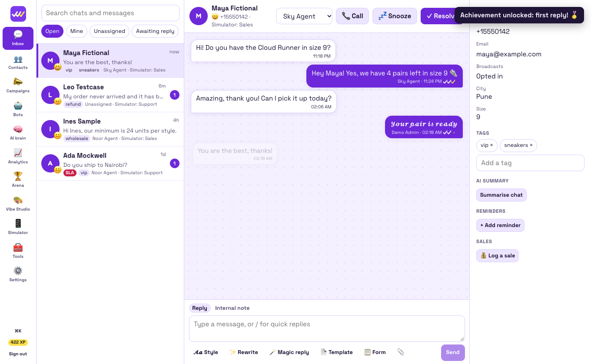

</div>

**Sent ✓ Delivered ✓✓ Read ✓✓ Replied ✓✓✓.** The third tick lights up when a customer actually reacts, and it's the number your campaigns get measured on.

Triple Tick is an independent project. It isn't affiliated with or endorsed by Meta, WhatsApp, or DoubleTick. It's a clean-room build based only on publicly documented features.

## Try it in a minute

You need Node 22.18 or newer. You don't need a Meta account: the built-in Simulator plays the phone network.

```bash
npm install
npm run demo
```

Open <http://localhost:4310> and sign in with `demo@tripletick.local` / `tripletick`. All the demo data is made up.

Open the **Simulator** in a second tab, play the customer, and reply from the **Inbox**. Try saying `menu`, `STOP`, or `This is terrible, I want a refund`.

## Screenshots

| | |
| --- | --- |
| 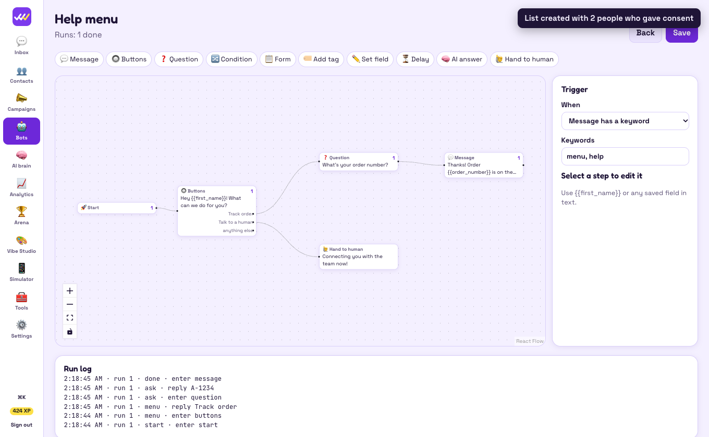 **Bot builder** with live run log | 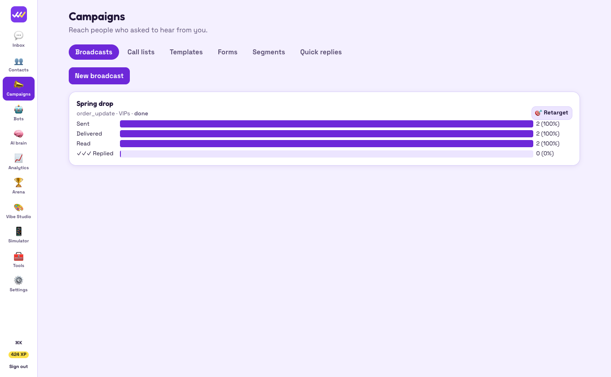 **Campaigns** with delivery funnels |
| 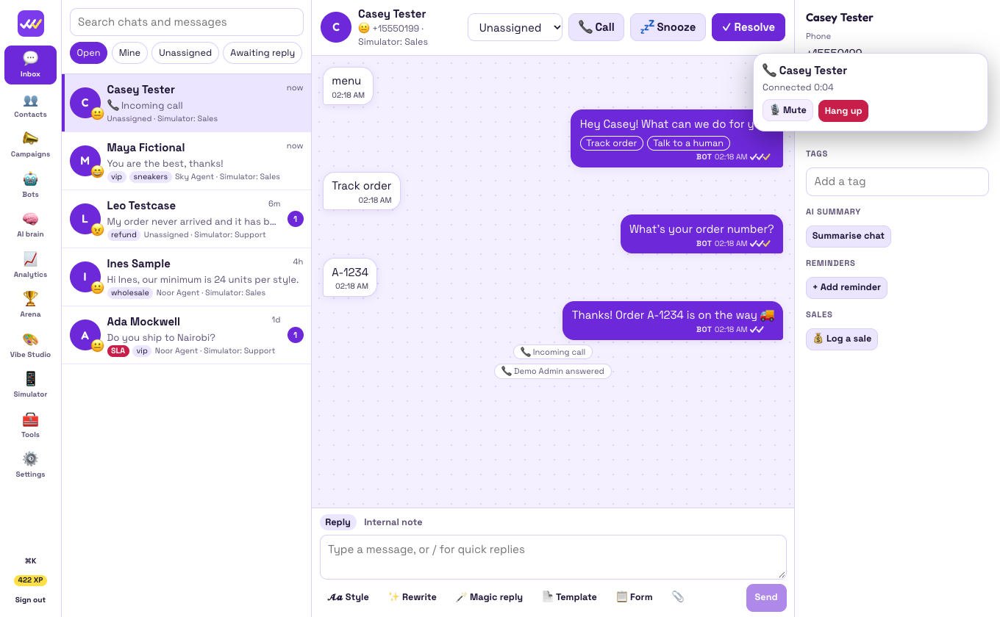 **Voice calls** in the browser | 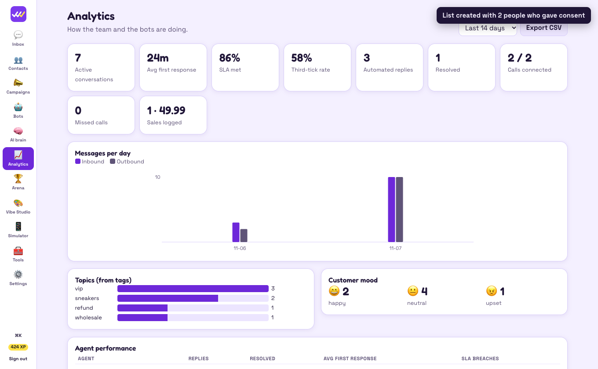 **Analytics** |
| 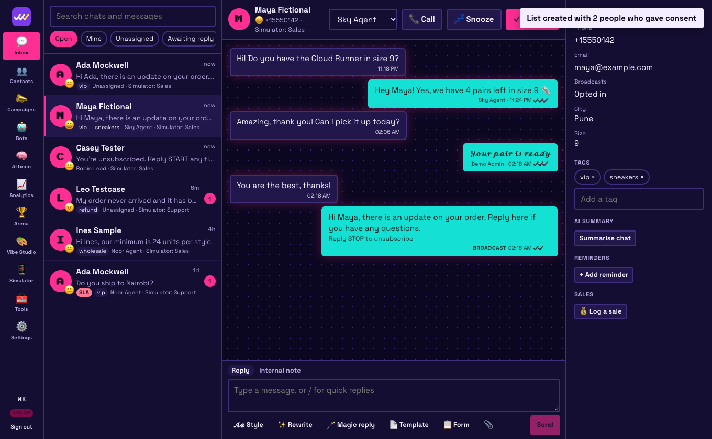 **Neon** theme | 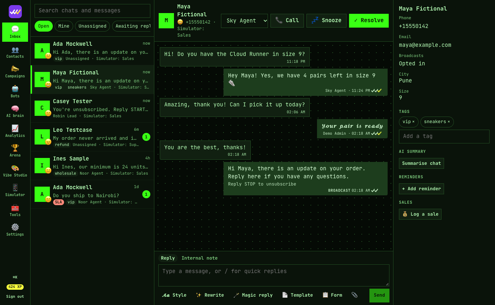 **Terminal** theme |
| 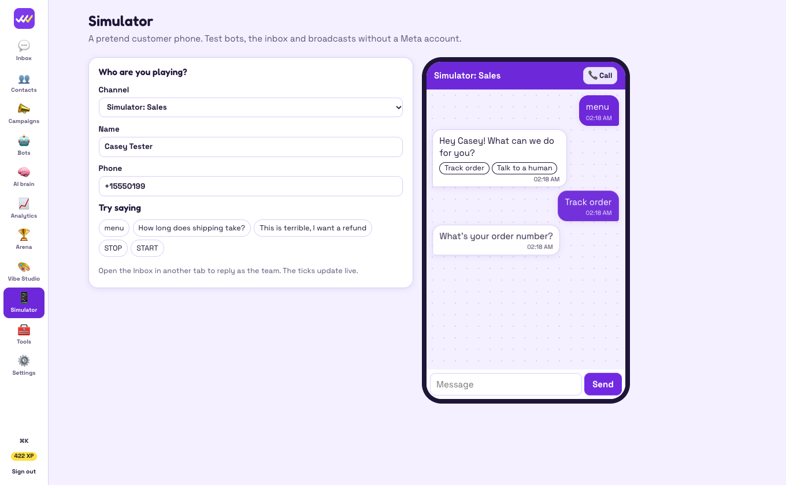 **Simulator**, no Meta account needed | 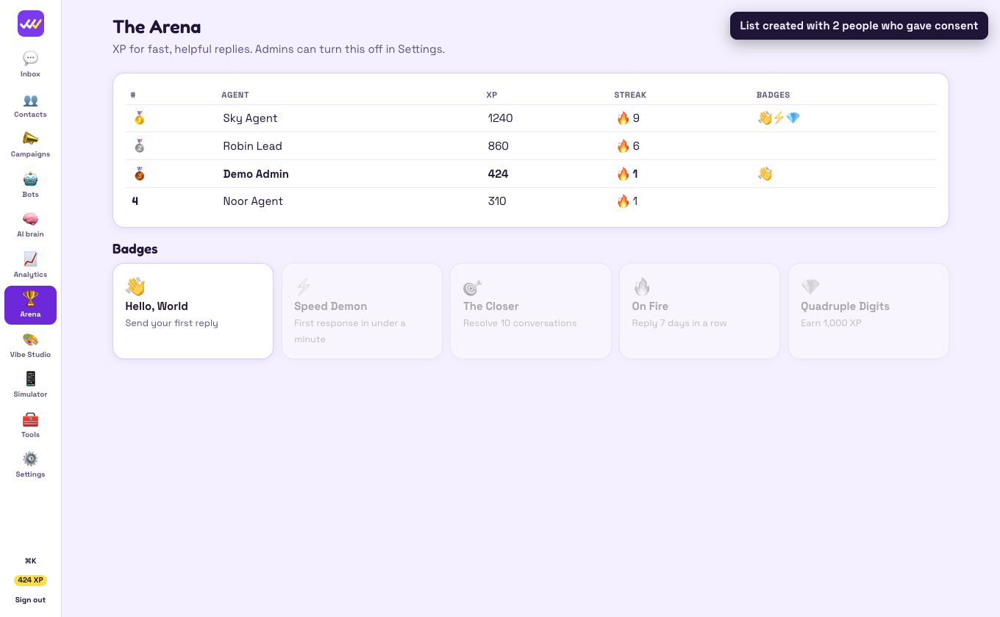 **Arena** leaderboard |

<p align="center">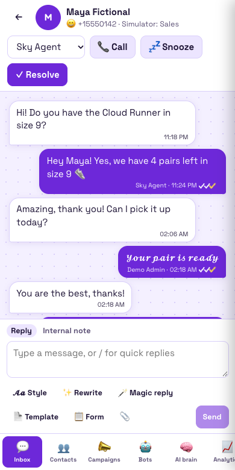 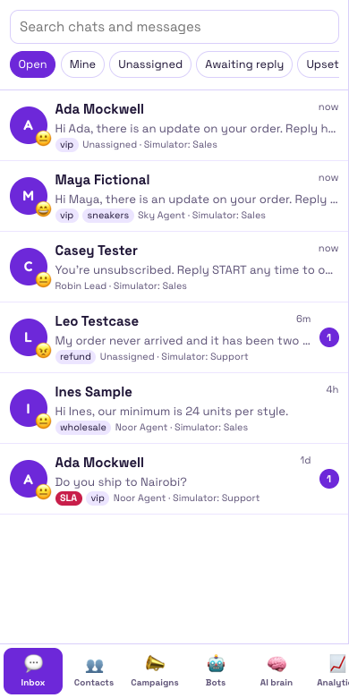</p>

More in [docs/screenshots](docs/screenshots).

## How it compares

| | Triple Tick | [Chatwoot](https://github.com/chatwoot/chatwoot) | Paid WhatsApp inboxes |
| --- | --- | --- | --- |
| Focus | WhatsApp, end to end | Many channels | WhatsApp |
| Price | Free, no seat limits | Free community edition, paid tiers | Per seat, per month |
| Try it with no Meta account | ✅ Built-in Simulator | ❌ | ❌ |
| Setup | One Node process, built-in SQLite | Rails, Postgres, Redis | Hosted for you |

## What's free, and what isn't

The software costs nothing, with no seat limits, no feature tiers and no paid plan. Some things around it are outside this project's control:

| Cost | Who charges | Can you avoid it? |
| --- | --- | --- |
| WhatsApp message fees | Meta, directly on your account | No, for real WhatsApp traffic. The Simulator is free. |
| Hosting | Your server provider | Run it on hardware you already have |
| Claude AI usage | Anthropic, only if you add a key | Yes. Without a key, offline helpers handle these features at a simpler level. |

## Features

**Team inbox:** multiple numbers in one inbox, live updates, assignment and round robin, internal notes, tags, snooze, reminders, saved views, advanced filters, awaiting-reply tracking, quick replies with `/`, and attachments.

**Calls:** real voice calls in the browser in both directions over WhatsApp's Calling API, with an incoming call dock, mute, automatic call logging, missed call handling, and scripted call lists with outcomes.

**Campaigns:** broadcasts with scheduling, segments, delivery funnels, one-click retargeting, templates submitted to and synced with Meta, click-to-WhatsApp ad attribution, and sales reported back to Meta Ads.

**Forms:** in-chat forms using WhatsApp Flows, with answers saved straight onto the contact. They work as a bot step too.

**Automation:** a drag-and-drop bot builder, keyword and working-hours triggers, a run log, per-step visit counts, and away messages.

**AI:** an agent that answers from your knowledge base and hands off when unsure, chat summaries, magic replies, and rewrite and translate. It uses Claude when you add a key.

**Team and governance:** a reporting hierarchy with scoped visibility, SLA tracking, an audit log, masking of customer phone, email and card numbers, and blocking agents from sharing their own contact details.

**Analytics:** agent performance, topic and mood charts, campaign funnels, and CSV export.

**Integrations:** HubSpot, Salesforce and Zoho contact sync, Shopify abandoned carts and order messages, and an inbound hook for Tally, Pabbly, Zapier, Make, Google Sheets scripts or anything that can POST JSON.

**For developers:** a REST API with keys, signed outbound webhooks that work with Zapier, Make and n8n, CSV import and export, an embeddable chat view, and a chat link and QR generator.

**Anywhere:** installs as an app on phones and desktops, with push notifications that show who messaged but never what they said.

### Extras you won't find elsewhere

- **The third tick** and a third-tick rate metric
- **Vibe Studio:** 10 themes, all tested against WCAG AA contrast, plus a custom theme builder and share codes
- **16 message text styles** in real Unicode, so 𝓼𝓬𝓻𝓲𝓹𝓽, 𝕕𝕠𝕦𝕓𝕝𝕖 and ｖａｐｏｒ reach the customer's phone styled
- **Personal look:** 8 fonts including a highly legible one, text size, bubble shapes, chat wallpapers and synthesised sound packs
- **The Arena:** XP, streaks, badges and a leaderboard, which admins can switch off
- **Mood ring** on every chat, confetti on resolve, and a ⌘K command palette
- **The Simulator** for testing everything with no account

### Not built yet

- **AI voice agents:** a bot that talks on calls needs a realtime audio server plus speech recognition and synthesis. Today's calls are person to person, and call lists are dialled by people.
- **Store apps:** Triple Tick installs from the browser with push notifications, but there are no App Store or Play Store builds yet.
- **Compliance certificates:** DoubleTick advertises ISO 27001 and SOC 2. Those certify a company, not code, so a self-hosted install needs its own.

Pull requests are very welcome. See [CONTRIBUTING.md](CONTRIBUTING.md).

## Going live on WhatsApp

1. Create an app at [developers.facebook.com](https://developers.facebook.com) and add the WhatsApp product.
2. Deploy Triple Tick at a public HTTPS URL and set `TT_PUBLIC_URL`.
3. In **Settings → Channels**, choose **Connect WhatsApp number** and paste your IDs, access token and app secret.
4. In Meta's webhook settings, use `https://your-host/webhooks/whatsapp` with your verify token, and subscribe to `messages`.

Triple Tick uses only the official Cloud API. Unofficial WhatsApp Web automation breaks WhatsApp's terms and gets numbers banned.

The adapter is tested against mocked API responses and documented payloads, not yet against a live Meta account, so try it with a test number first.

### Extra setup for each feature

- **Calls:** enable calling on your number, subscribe to the `calls` webhook field, and use HTTPS. Customers must allow calls before you can ring them, so Triple Tick offers to send that request. If agents get no audio on restrictive networks, add a TURN server with `TT_ICE_SERVERS`.
- **Forms:** build the Flow in WhatsApp Manager, then paste its ID and first screen into the form. The questions you enter in Triple Tick drive the Simulator, and answer keys from your Flow become contact fields.
- **Meta Ads:** add the dataset ID from your WhatsApp Business Account. Only sales logged in a chat that came from a click-to-WhatsApp ad are sent. Shopify orders stay in your own reports, because Meta wants website sales on its web Conversions API.
- **Salesforce:** add a unique external ID field called `TripleTick_Id__c` to Contact. Access tokens expire, so reconnect if syncing fails.
- **HubSpot and Zoho:** only contacts with an email address sync.
- **Shopify:** point `orders/create` and `checkouts/create` webhooks at the URL shown after connecting, using the signing secret shown in Shopify.

## Built-in guardrails

These can't be switched off, because they keep your number from being banned and your customers from being spammed:

- Free-form messages are blocked outside WhatsApp's 24-hour window
- Broadcasts need an approved template and reach only opted-in contacts
- `STOP` opts a customer out, and only the customer's `START` undoes it
- A frequency cap and rate limit apply to every broadcast
- Call lists and cart reminders reach only consenting contacts, and Shopify's marketing checkbox can't override a `STOP`

## Deploying

```bash
docker compose up -d --build
```

Put it behind a reverse proxy that handles HTTPS. Never set `TT_DEMO` in production. See `.env.example` for all the options.

Access tokens and signing secrets are encrypted with AES-256-GCM. Set `TT_SECRET_KEY`, or Triple Tick creates `secret.key` in the data folder. Back up your data, but keep the key apart from your database backups: anyone with both can read your tokens, and if you lose the key you'll need to re-enter them. Customer messages and contacts aren't encrypted by the app, so use disk encryption too.

## API

Create a key in **Settings → Developers**. Keys have full admin access, so treat them like passwords.

```bash
curl -H "Authorization: Bearer tt_..." https://your-host/api/conversations

curl -X POST -H "Authorization: Bearer tt_..." -H "content-type: application/json" \
  -d '{"body":"Hello!"}' https://your-host/api/conversations/1/messages
```

Webhooks send `message.received`, `message.sent`, `message.status`, `sla.breached` and `conversion.created`. Verify `x-tripletick-signature`, which is `sha256=` plus the HMAC-SHA256 of the raw body with your signing secret.

## Development

```bash
npm run dev        # API on :4310, web on :5173, with reload
npm test           # server and web tests
npm run typecheck
npm run e2e        # browser test, against a running npm run demo
```

The browser test uses your installed Google Chrome, because the macOS firewall blocks call audio to Playwright's own unsigned browser.

The server is Node with built-in SQLite and native TypeScript, with Fastify on top. The web app is React and Vite. To add a messaging channel, implement the small `ChannelAdapter` interface in `server/src/channels/`.

## License

[MIT](LICENSE)
